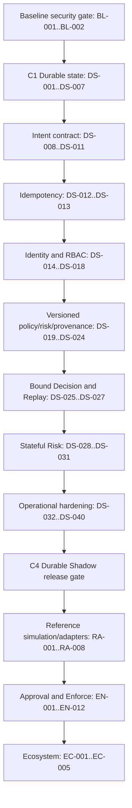

# ATF Delivery Plan

Updated: 2026-08-08
Planning baseline: `main` at `73ef1c1`

## 1. Purpose and source of truth

This plan turns the original `prd-v1.md` vision into an executable delivery
sequence grounded in the code that exists today. Product requirements remain
authoritative in `docs/PRD.md` v1.3; security evidence and gap severity remain
authoritative in `docs/audit-gap-matrix.md`.

The original PRD grouped work by product module. This plan orders work by
dependency and security boundary instead:

1. durable state before stateful security controls;
2. validated and authenticated admission before shared deployment;
3. versioned inputs before Decision binding and Replay;
4. observable, re-audited Shadow Mode before Simulator or Adapter work;
5. Approval and single-use authorization before any execution path.

The P0.x labels in the PRD identify capabilities, not a safe literal build
order. In particular, Policy Bundle and Risk Rule Set hashes must exist before
`EvaluationContext`, bound Decisions, and deterministic Replay can be complete.

## 2. Verified starting point

### Implemented and wired

- Fixed-point `Amount`, timestamps, ULIDs, canonical JSON sorting and SHA-256.
- Transaction Intent JSON Schema parsing, typed deserialization and canonical
  Intent hash.
- Basic Cedar Policy evaluation and Policy conformance CLI.
- Five stateless Risk rules plus organization-scoped duplicate-purchase
  detection based on prior `DecisionRecorded(PERMIT)` events.
- Policy/Risk Decision merge, hash-chained Audit, and a live evaluate-only
  Gateway with four PostgreSQL-backed routes.
- CI workflow jobs for fmt, clippy, tests and `cargo deny`.

Planning-time verification found that fmt, clippy and all 80 tests passed,
while `cargo deny 0.20.2` initially failed: two transitive licenses were not
explicitly reviewed/allowed and local workspace path dependencies were
rejected by the wildcard rule. `BL-001` was defined to repair this baseline
before feature work rather than treat a configured CI job as a passing gate.

BL-001 was completed on 2026-08-07 with the restrictive wildcard/source policy
intact. BL-002 made that gate warning-free on 2026-08-08 by denying new
duplicate versions, documenting exact current compatibility exceptions,
checking all features and targets, and promoting cargo-deny warnings to CI
errors. DS-001 was completed on 2026-08-07 by accepting ADR-0002: PostgreSQL is
the single durable boundary, Audit chains serialize per organization, and
admission/finalization plus fenced evaluator recovery have explicit
invariants. DS-002 was completed on 2026-08-08 with the `atf-store` boundary,
embedded migration runner, constrained base Schema, append-only triggers, and
real PostgreSQL migration CI. DS-003 was completed on 2026-08-08 with
row-locked per-organization append, consistent-snapshot reload/verification,
explicit event occurrence time, and real concurrent/corruption PostgreSQL
tests. DS-004 was completed on 2026-08-08 with two coarse-grained repository
transactions, canonical record verification, evidence-gated reads, and
injected Audit-failure rollback tests. DS-005 was completed on 2026-08-08 by
making those repositories the Gateway's only Decision/Audit path, adding live
storage readiness, and proving restart/second-instance reads plus durable Risk
history on real PostgreSQL. DS-006 completed the lifecycle and typed Audit
domain contract. DS-007 completed transactional lifecycle persistence, typed
phase emission, replay verification, and stale-writer rejection. DS-008 closed
the Intent envelope/version contract. DS-009 added deterministic common
semantic validation and migrated the valid fixture from a pseudo-ULID and
multi-decade TTL to the declared contract. DS-010 added closed Profile
dispatch, the supported Agent-Commerce Payment profile, CAIP-bound fixtures,
and unsupported-action rejection. DS-011 added safe structured Gateway errors,
server-owned request IDs and validation-order evidence. DS-012 added atomic
idempotency reservation/result transactions, database-clock evaluator leases,
renewal/reclaim and generation fencing. DS-013 added exact completed retry,
stage-boundary heartbeat, concurrent result convergence and request-driven
fail-closed recovery. DS-014 added the canonical domain-separated Identity
Envelope and exact-key verifier. DS-015 added restart-safe Agent/Key lifecycle,
atomic operator Audit evidence and offline provisioning. DS-016 added strict
Gateway identity Headers/configuration, current durable exact-Key verification,
atomic hashed-Nonce admission and typed rejection/replay evidence. ADR-0003 was
explicitly accepted on 2026-08-08 as DS-017; DS-018 now implements it with
durable Operator/Role lifecycle, configured JWT/JWKS validation, typed
principals and non-enumerating Decision-read RBAC. DS-019 now provides
validated Policy Bundle identity, and DS-020 adds signed durable activation
and rollback. DS-021 now adds the canonical versioned Risk Rule Set and exact
identity in Risk results/evidence. DS-022 adds provenance-bearing Evidence and
the privileged-context firewall. DS-023 now persists one immutable Evaluation
Context before Policy/Risk. DS-024 now makes that persisted Context the only
decision-input authority consumed by both evaluators. DS-025 now seals those
inputs and the merge output into one closed canonical Decision; the next task
is DS-026 Original Replay.

### Present but incomplete or unwired

- Agent identity is wired before Policy/Risk with PostgreSQL-authoritative
  Nonce replay protection. Operator authentication and current Decision-read
  authorization are wired. Policy activation/rollback now have an explicit
  authenticated role matrix; future Admin/Audit endpoints still need their
  own capability matrices.
- Decision v1 binds Intent/Profile, exact Policy/Risk artifacts, Evaluation
  Context/snapshot, explicit Simulation state, evaluation/expiry times, future
  Approval/Obligation sets and execution constraints under one
  domain-separated canonical hash.
- Policy now has a closed manifest, Cedar schema, scope/time validity,
  deterministic version/hash, detached Ed25519 signature, immutable archive,
  active pointer and immediate rollback. The selected artifact is now bound in
  the durable Evaluation Context and the strongly bound Decision.
- Policy and Risk now expose only Context-authorized evaluation entry points.
  Gateway pins the exact inputs before execution; time, Evidence, artifact
  identity and Audit boundary are taken from that Context, while mismatch and
  later history fail closed.
- Gateway Policy/Risk/Simulation evidence is canonical, typed, and emitted as
  intermediate events. Current admissions emit `IdentityVerified`; the old
  `IdentityVerificationSkipped` branch is compatibility-only.
- `atf-store` is wired for admission/finalization, contract-v1 lifecycle
  replay, and atomic idempotency lease/result fencing. Gateway now returns
  exact completed results and recovers expired admissions on retry; there is
  no background recovery scanner or Context-based deterministic recomputation.
- `X-ATF-Organization-ID` remains a tenant selector rather than a credential;
  protected routes derive authority from their validated Agent or Operator
  principal and re-check current durable lifecycle state.

### Missing release controls

- Deterministic Context-based recovery; Agent and Operator authentication,
  durable Agent/Key/Operator/Role authority, authenticated Nonce replay
  protection, exact result return and restrictive request-driven recovery are
  complete.
- Supported action profiles; common Rust semantic validation is complete.
- Context-only evaluation and Replay; Evaluation Context persistence,
  Agent/Operator tenant authority and DS-022 provenance types/firewall are
  complete, while future Admin/Audit endpoints still require their
  endpoint-specific role matrices.
- Audit query, metrics, request limits, background recovery operations and
  security CI gates; request-driven restrictive recovery tests are complete.
- Simulator, Approval, Adapter execution, reconciliation and SDKs.

## 3. Non-negotiable delivery rules

- Shadow-only until checkpoint C4 is passed and reviewed.
- No real wallet/exchange credentials in ATF core or test fixtures.
- All money remains fixed-point; no floating point in financial domain types.
- Unknown, stale, malformed or unavailable decision input fails closed.
- Every deterministic hash uses `atf_core::sort_json_keys` and explicit domain
  separation where the hash crosses a trust boundary.
- Every feature is one self-contained commit. Do not combine adjacent TODOs
  without explicitly revising this plan.
- A task is complete only when its acceptance criteria and the Definition of
  Done below both pass.

## 4. Project Definition of Done

Every implementation task must satisfy all applicable items:

- New behavior has tests that fail without the change, including error paths.
- `cargo fmt --all -- --check` passes.
- `cargo clippy --all-targets --all-features -- -D warnings` passes.
- `cargo test --workspace --all-targets --all-features` passes.
- `cargo deny check -D warnings` passes.
- Runtime behavior is exercised through the real binary/API when applicable.
- Schema, migration, compatibility, security and rollback effects are handled.
- `README.md`, `docs/architecture.md`, roadmap and gap evidence stay truthful.
- No unrelated refactor, dead code, debug output or sensitive log data remains.
- A human reviews the task before merge or deployment.

## 5. Dependency graph and checkpoints

| Checkpoint | Exit condition | Explicitly still unavailable |
|---|---|---|
| C0 Plan accepted | Human approves ordering, storage boundary and auth decision gates | Implementation has not started |
| C1 Durable state | DS-001..DS-007; restart and concurrent Audit append work | Shared/anonymous deployment remains unsafe |
| C2 Trusted admission | DS-008..DS-018; invalid, duplicate, replayed or unauthenticated requests cannot reach Policy/Risk | C3 Decision/Replay work remains outside this checkpoint |
| C3 Reproducible decisions | DS-019..DS-027; exact inputs are versioned, bound and replayable | Operational release gate remains closed |
| C4 Durable Shadow | DS-028..DS-040; relevant CRITICAL/HIGH gaps have executable evidence and re-audit | Real execution and production-readiness claims remain forbidden |
| C5 Reference controls | RA-001..RA-008; simulation and three adapters work in Shadow/Mock mode under conformance | Enforce Mode remains disabled |
| C6 Enforce candidate | EN-001..EN-012; approval, grants, kill switch and reconciliation pass independent review | Production deployment still requires operator-specific review |

### Audit-gap coverage

| Gap | Planned closure/evidence |
|---|---|
| GAP-INT-001/002 | DS-008..DS-011; additional protocol profiles in RA-005..RA-007 |
| GAP-IDN-001 | DS-014..DS-016 |
| GAP-API-001 | DS-017..DS-018, DS-032, DS-034 |
| GAP-RPL-001 | DS-012..DS-016, then EN-005/EN-011 for execution/proof nonces |
| GAP-POL-001 | DS-019..DS-020 |
| GAP-RSK-001 | DS-021..DS-024, DS-028..DS-031, RA-005..RA-007 |
| GAP-CTX-001 | DS-022..DS-024 |
| GAP-RPY-001 | DS-023..DS-027 |
| GAP-BUD-001 | EN-001..EN-002 before Enforce Mode |
| GAP-SIM-001 | RA-001..RA-002 |
| GAP-DEC-001 | DS-025, then RA-001 for Simulator binding |
| GAP-APR-001 | EN-003..EN-004 |
| GAP-EXE-001 | EN-005..EN-007 |
| GAP-ADP-001 | RA-003..RA-008 and EN-008..EN-010 |
| GAP-REC-001 | EN-011 |
| GAP-AUD-001 | DS-001..DS-007, DS-032 and C4 review of checkpoint/retention residuals |
| GAP-PER-001 | DS-001..DS-007, DS-036, DS-039 |
| GAP-SEC-001 | DS-011, DS-018, DS-033..DS-035 |
| GAP-OBS-001 | DS-033 |
| GAP-CI-001 | BL-001..BL-002, DS-036..DS-038; artifact gates expand at EN-012 |
| GAP-DOC-001 | Every feature DoD, DS-040, RA-008 and EN-012 |
| GAP-PRD-001 | DS-039..DS-040; production remains a separate operator review after EN-012 |

## 6. Baseline repair

### BL-001 — Restore the current `cargo deny` gate `[S]`

**Status:** Complete (2026-08-07).

**Description:** Review and explicitly allow or reject the newly encountered
`Apache-2.0 WITH LLVM-exception` and `MIT-0` transitive licenses, version local
workspace path dependencies so `wildcards = "deny"` remains meaningful, and
pin CI to the reviewed cargo-deny behavior.

- **Dependencies:** C0 approval.
- **Likely files:** `Cargo.toml`, `deny.toml`, `.github/workflows/ci.yml`,
  `Cargo.lock`.
- **Acceptance criteria:**
  1. `cargo deny 0.20.2 check` passes without disabling license/source checks.
  2. Every new license allowance has a dependency-path rationale and local path dependencies remain version-bound.
  3. Local and CI cargo-deny versions/configuration agree.
- **Verification:** `cargo deny check`, full DoD and a reviewed CI run.

### BL-002 — Enforce a warning-free dependency baseline `[S]`

**Status:** Complete (2026-08-08).

**Description:** Close BL-001's warning-only duplicate-version gap without
discarding target coverage or weakening advisory, license, source, or wildcard
checks. New duplicate families are denied; only exact locked versions with an
upstream dependency-path reason may be skipped. CI promotes every remaining
warning to an error, including unmatched/stale skip entries.

- **Dependencies:** BL-001 and the DS-016 locked dependency graph.
- **Implemented files:** `deny.toml`, `.github/workflows/ci.yml` and baseline
  documentation.
- **Acceptance criteria:**
  1. `cargo deny 0.20.2 check -D warnings` reports all four checks `ok` with no warning/error diagnostics.
  2. A newly introduced duplicate fails by default; exceptions name one exact version and explain the upstream incompatibility.
  3. The graph continues to include all resolved targets and retains wildcard, unknown-source, advisory, and license enforcement.
- **Verification:** pre-change `-D warnings` failed on 23 duplicate families;
  the reviewed configuration and pinned CI command now pass warning-free.

## 7. Phase 2 — Durable Shadow Mode

### DS-001 — Decide the durable transaction and Audit-chain contract `[S]`

**Status:** Complete (2026-08-07).

**Description:** Add ADR-0002 selecting a shared PostgreSQL storage boundary,
per-organization Audit chains, chain-head locking, and two short transactions:
admission and finalization. Define evaluator crash/lease behavior and migration
rollback before writing storage code.

- **Dependencies:** BL-001.
- **Likely files:** `docs/decisions/0002-durable-state-contract.md`,
  `docs/architecture.md`, `docs/threat-model.md`, `docs/roadmap.md`.
- **Acceptance criteria:**
  1. Intent/idempotency admission and Decision/Audit finalization atomicity are explicit.
  2. Concurrent per-organization append and crash-recovery invariants are explicit.
  3. Rejected alternatives and rollback/compatibility policy are recorded.
- **Verification:** ADR review against PRD §16 and GAP-PER/AUD/RPL; Markdown link check.

### DS-002 — Create the PostgreSQL store and initial migration `[M]`

**Status:** Complete (2026-08-08).

**Description:** Add `atf-store` as the single persistence boundary and an
initial migration for organizations, intents, evaluations, decisions, Audit
events, Audit heads and schema metadata. Store canonical JSON and hashes; add
foreign keys, tenant keys and append-only protections.

- **Dependencies:** DS-001.
- **Likely files:** `Cargo.toml`, `crates/atf-store/Cargo.toml`,
  `crates/atf-store/src/lib.rs`, `migrations/0001_durable_shadow.sql`,
  `crates/atf-store/tests/migrations.rs`.
- **Acceptance criteria:**
  1. A clean PostgreSQL database migrates to the declared schema.
  2. Tenant uniqueness/FK constraints reject invalid cross-record state.
  3. Existing Audit rows cannot be updated or individually deleted by the app role.
- **Verification:** `cargo test -p atf-store --test migrations` against PostgreSQL; full DoD.

### DS-003 — Implement concurrent per-organization Audit append `[M]`

**Status:** Complete (2026-08-08).

**Description:** Persist typed Audit events using a locked organization chain
head so concurrent writers cannot fork a chain. Reload and verify a chain from
the database using deterministic event hashes and explicit occurrence time.

- **Dependencies:** DS-002.
- **Likely files:** `crates/atf-store/src/audit.rs`,
  `crates/atf-store/src/error.rs`, `crates/atf-audit/src/event.rs`,
  `crates/atf-store/tests/audit_postgres.rs`.
- **Acceptance criteria:**
  1. Concurrent same-org appends produce one valid linear chain.
  2. Different organizations have independent genesis/head records.
  3. Restarted verification detects deletion, mutation and reordering.
- **Verification:** concurrent PostgreSQL integration test plus chain tamper test; full DoD.

### DS-004 — Add admission and finalization repository transactions `[M]`

**Status:** Complete (2026-08-08).

**Description:** Implement the ADR's short transactions: admission persists the
Intent and `IntentReceived`; finalization persists Evaluation, Decision,
`DecisionRecorded` and final result atomically. Do not hold a DB transaction
while Policy/Risk executes.

- **Dependencies:** DS-003.
- **Likely files:** `crates/atf-store/src/repository.rs`,
  `crates/atf-store/src/models.rs`, `crates/atf-store/src/error.rs`,
  `crates/atf-store/tests/repository.rs`.
- **Acceptance criteria:**
  1. A queryable Decision always has matching Evaluation and Audit evidence.
  2. Failed finalization exposes none of those final records.
  3. Canonical Intent/hash mismatch is rejected, not overwritten.
- **Verification:** injected transaction-failure tests and PostgreSQL integration tests; full DoD.

### DS-005 — Move Gateway state to PostgreSQL `[M]`

**Status:** Complete (2026-08-08).

**Description:** Replace the in-memory Decision map and Audit ledger in the
request path with the store. Configure database connection/migrations and make
readiness reflect dependency health.

- **Dependencies:** DS-004.
- **Likely files:** `services/gateway/src/state.rs`,
  `services/gateway/src/routes.rs`, `services/gateway/src/main.rs`,
  `services/gateway/Cargo.toml`, `services/gateway/tests/routes.rs`.
- **Acceptance criteria:**
  1. Restart or a second Gateway instance returns the original Decision.
  2. `/readyz` is non-ready when required storage is unavailable.
  3. The production request path contains no Decision/Audit `Mutex<HashMap>` fallback.
- **Verification:** run two real Gateway processes against one DB and curl POST/GET/restart; full DoD.

**Delivered boundary:** PostgreSQL is required and pre-migrated at startup;
organizations are explicitly provisioned. POST uses the DS-004 admission and
finalization transactions, Risk consumes verified durable Audit events, GET
requires a validated Operator JWT, a current durable organization read role,
and `X-ATF-Organization-ID` as selector; readiness checks live schema and JWKS
access. ADR-0003's authenticated organization boundary is implemented by
DS-018. DS-012 now
supplies atomic reservation,
lease/fencing and result binding; DS-013 now supplies exact completed retry and
request-driven admitted-work recovery.

### DS-006 — Define lifecycle states and typed Audit payloads `[M]`

**Status:** Complete (2026-08-08).

**Description:** Add stable lifecycle states, terminal states and a pure
transition validator covering the complete PRD lifecycle while allowing
unimplemented stages only as explicit `NOT_RUN` outcomes. Replace
decision-relevant free-form Audit payloads with typed, schema-validated data.

- **Dependencies:** DS-001.
- **Likely files:** `crates/atf-core/src/lifecycle.rs`,
  `crates/atf-audit/src/event.rs`, `schemas/audit-event.schema.json`,
  `crates/atf-audit/tests/schema_validation.rs`, `docs/audit-model.md`.
- **Acceptance criteria:**
  1. Every allowed transition is enumerated and invalid/backward transitions fail.
  2. Terminal `DENY`, `ERROR`, `EXPIRED` and `CANCELLED` states cannot advance.
  3. Each lifecycle event has a typed payload and maps to a transition or explicit non-state event.
- **Verification:** transition-table unit/property tests; full DoD.

**Delivered boundary:** DS-006 originally established 21 stable states and 27
events; DS-007 adds the explicit Shadow-only `IDENTITY_UNVERIFIED` state and
`IdentityVerificationSkipped` event. `atf-core` remains the only pure
transition table, now exhaustively testing all 484 state pairs and every
terminal successor. `atf-audit` owns 37 canonical version-1 payload variants
(33 before DS-018), including Operator/Role lifecycle evidence, tagged
required/optional module outcomes, intent-scope validation, and explicit event
effects. Real typed Rust output is checked against a closed JSON Schema, and
the store's admission/finalization/lifecycle producers no longer assemble
free-form Audit JSON.

### DS-007 — Enforce lifecycle transitions transactionally `[M]`

**Status:** Complete (2026-08-08).

**Description:** Store lifecycle state/version with each Intent and advance it
with the matching Audit event in one transaction. Record explicit evaluation
failure rather than leaving accepted requests silently in progress.

- **Dependencies:** DS-004, DS-005, DS-006.
- **Implemented files:** `migrations/0002_intent_lifecycle.sql`,
  `crates/atf-store/src/lifecycle.rs`, `crates/atf-store/src/repository.rs`,
  `services/gateway/src/routes.rs`, `crates/atf-store/tests/repository.rs`.
- **Acceptance criteria:**
  1. State and matching Audit event are atomically visible.
  2. Optimistic version/locking prevents concurrent invalid transitions.
  3. Policy/Risk failure commits an explicit `DECIDED_ERROR` when storage is
     healthy; store/Audit failure rolls the attempted batch back and fails the
     request closed without claiming a durable Decision.
- **Verification:** race and injected-failure integration tests; real Gateway failure smoke; full DoD.

**Delivered boundary:** DS-007 originally made new Intents commit `RECEIVED/v1`
with `IntentReceived` and finalized through the explicit
`IdentityVerificationSkipped` compatibility phase. DS-016 supersedes that
producer: new accepted Gateway Intents atomically advance through
`IntentReceived -> IdentityVerified` to `IDENTITY_VERIFIED/v2`, then
finalization commits `PolicyEvaluated`, `RiskEvaluated`,
`SimulationCompleted`, and `DecisionRecorded` with the Evaluation, Decision,
and `DECIDED_*/v6` materialization. Contract-v1 readers replay typed events
and compare state/version/event pointer/time. Legacy `IDENTITY_UNVERIFIED`
evidence remains readable but is never promoted as authenticated.

### DS-008 — Close the Intent envelope and version contract `[S]`

**Status:** Complete (2026-08-08).

**Description:** Reject unknown core envelope fields, define supported
`spec_version` values, and keep extensions only in hash-bound `context` or
`metadata`. Prove Schema-to-Rust-to-canonical round trips do not drop data.

- **Dependencies:** DS-007.
- **Likely files:** `schemas/transaction-intent.schema.json`,
  `crates/atf-intent/src/types.rs`, `crates/atf-intent/src/validate.rs`,
  `crates/atf-intent/tests/canonical_contract.rs`.
- **Acceptance criteria:**
  1. Unknown core fields and unsupported spec versions are rejected.
  2. Every accepted field survives typed round-trip and affects the Intent hash.
  3. Existing valid v1 fixtures remain compatible or receive a documented migration.
- **Verification:** Schema/Rust round-trip and mutation tests; CLI fixture smoke; full DoD.

**Delivered boundary:** The top-level Schema is closed, all typed core structs
reject unknown fields during direct Serde parsing, and Schema plus Rust accept
only `spec_version: "1.0"`. `context` and `metadata` remain arbitrary but must
be JSON objects; their complete content survives typed round trips and affects
the canonical hash. Tests mutate every mutable v1 leaf, exercise both parse
paths, and lock the then-current x402 fixture hash. Cross-field semantics and
stable library error codes were deferred to DS-009 and are now complete; the
fixture received DS-009's documented ULID/TTL migration. Action profiles
were deferred to DS-010; that task now supports one Payment profile and
rejects every other action. DS-011 now supplies the HTTP error-envelope
contract; DS-012 now supplies atomic idempotency reservation/result and
evaluator fencing, while DS-013 supplies exact retry/recovery semantics.

### DS-009 — Add Rust semantic validation with stable codes `[M]`

**Status:** Complete (2026-08-08).

**Description:** Validate positive amount/leverage, non-negative fee,
slippage bounds, time ordering/max TTL, ULID and bounded nonblank identifiers.
Return stable machine-readable errors rather than formatted library strings.

- **Dependencies:** DS-008.
- **Likely files:** `crates/atf-intent/src/semantic.rs`,
  `crates/atf-intent/src/error.rs`, `crates/atf-intent/src/lib.rs`,
  `crates/atf-intent/tests/semantic.rs`,
  `schemas/transaction-intent.schema.json`.
- **Acceptance criteria:**
  1. Every PRD §9.5 common invariant has a stable error code and boundary test.
  2. Multiple invalid fields are reported deterministically.
  3. Validation never normalizes a dangerous value into a valid one.
- **Verification:** table/boundary tests, structured error-order tests,
  `atf validate-intent` negative smoke, Gateway/PostgreSQL pre-admission test,
  and full DoD.

**Delivered boundary:** `atf_intent::validate` now performs deterministic
common semantic validation after Schema and typed parsing. Positive financial
values, fee/slippage bounds, millisecond-safe ordered timestamps with a
24-hour maximum lifetime, ULID syntax, 256-byte identifier limits, and
1024-byte purpose limits return ordered `SemanticViolation { code, field }`
values without trimming or coercion. CLI failures exit non-zero; a real
Gateway/PostgreSQL test proves semantic rejection occurs before admission and
therefore before Policy/Risk. Previously valid-looking fixtures used
24-character pseudo-ULIDs and multi-decade TTLs, so they received a documented
migration and new golden hash. DS-010 now adds the supported Payment-specific
validation and rejects all other actions; the Gateway-wide
`{code,message,request_id,details}` response shape is now complete in DS-011.

### DS-010 — Add profile dispatch and the supported Payment profile `[M]`

**Status:** Complete (2026-08-08).

**Description:** Introduce versioned Intent Profile selection. Implement the
Payment/Agent-Commerce profile used by the x402 example and reject action
categories without an implemented profile instead of pretending they are safe.

- **Dependencies:** DS-009.
- **Likely files:** `crates/atf-intent/src/profile.rs`,
  `crates/atf-intent/src/profiles/payment.rs`,
  `schemas/profiles/payment-intent-v1.schema.json`, `docs/intent-spec.md`,
  `crates/atf-intent/tests/payment_profile.rs`.
- **Acceptance criteria:**
  1. Payment profile enforces resource/destination/fee relationships it declares.
  2. Unsupported action/profile pairs return `UNSUPPORTED_INTENT_PROFILE`.
  3. Profile ID/version is derivable and later bindable to Evaluation/Decision.
- **Verification:** profile conformance fixtures and x402 example CLI smoke; full DoD.

**Delivered boundary:** `atf_intent::validate` now dispatches a closed profile
set after common semantic validation. The supported
`atf.agent-commerce.payment` v1.0 selector is exactly
`spec_version=1.0` + `payment/purchase_api_resource`; it requires a typed
resource, CAIP-2 network, same-chain CAIP-19 asset and CAIP-10 destination,
and forbids contract/calldata/slippage/leverage fields. Profile ID/version is
read-only derivable metadata. Every other category/operation returns
`UNSUPPORTED_INTENT_PROFILE` before Gateway durable admission. The public
profile Schema and specification document structural/cross-field ownership;
the x402 example and conformance fixtures use CAIP identifiers and a newly
locked canonical hash. x402 proof/delivery semantics remain RA-005, while the
Gateway-wide safe error envelope is now complete in DS-011.

### DS-011 — Stabilize API errors and validation ordering `[S]`

**Status:** Complete (2026-08-08).

**Description:** Return `{code,message,request_id,details}` errors and guarantee
Schema, semantic and profile validation finish before durable admission and
before Policy/Risk. Internal messages must not leak SQL, policy or key material.

- **Dependencies:** DS-005, DS-009, DS-010.
- **Likely files:** `services/gateway/src/error.rs`,
  `services/gateway/src/routes.rs`, `services/gateway/src/lib.rs`,
  `services/gateway/tests/routes.rs`, `docs/api.md`.
- **Acceptance criteria:**
  1. Invalid requests return stable 4xx codes and never call Policy/Risk.
  2. Internal failures return safe 5xx codes with a correlation ID.
  3. Error JSON is covered by an API contract test.
- **Verification:** route spy/error-path tests and real curl negatives; full DoD.

**Delivered boundary:** all business-handler, Store, unknown-route and
method-not-allowed errors now use the exact top-level
`{code,message,request_id,details}` JSON contract. A fresh server-generated
ULID overrides any inbound request ID and is returned in
`X-ATF-Request-ID`; fixed safe messages never serialize raw input, Schema
diagnostics, SQL/database, policy or key/internal errors. Semantic/Profile
details expose only stable server-owned code/field pairs. PostgreSQL route
tests inspect reservation, Intent, Evaluation, Decision and Audit counts to prove UTF-8,
JSON, Schema, common-semantic and Profile rejection happens before durable
admission and therefore before authoritative Policy/Risk evidence. Store
unavailability, immutable conflict, tenant-safe not-found and Router 404/405
paths have the same contract. Health/readiness retain text bodies; full trace
and Audit request-ID propagation remains DS-033. Exact idempotency reservation
is complete in DS-012; exact retry/recovery is complete in DS-013.

### DS-012 — Add atomic idempotency reservation `[M]`

**Status:** Complete (2026-08-08).

**Description:** Add unique `(organization_id,idempotency_key)` records bound
to Intent hash and evaluator lease. Define `NEW`, `IN_PROGRESS`, `COMPLETED`
and terminal failure handling without holding long transactions.

- **Dependencies:** DS-004, DS-011.
- **Likely files:** `migrations/0003_idempotency.sql`,
  `crates/atf-store/src/idempotency.rs`, `crates/atf-store/src/error.rs`,
  `crates/atf-store/tests/idempotency.rs`.
- **Acceptance criteria:**
  1. Same key/different hash is an atomic `IDEMPOTENCY_CONFLICT`.
  2. Exactly one concurrent caller acquires the evaluator lease.
  3. Completed records immutably bind the stored Decision/hash.
- **Verification:** concurrent PostgreSQL race test; restart test; full DoD.

**Delivered boundary:** migration 0003 adds one immutable
`(organization_id,idempotency_key)` binding to the canonical Intent hash. The
admission transaction creates the reservation, Intent, lifecycle and
`IntentReceived` together. A database-clock lease has one opaque owner and a
monotonic generation; concurrent same-hash admission yields exactly one owner,
renewal keeps the generation, and expired reclaim increments it. Stale or
expired tokens cannot finalize. Until provenance-bearing Evaluation Context
exists, generation >1 can only commit `Decision(ERROR)`. Finalization changes
the reservation to immutable `COMPLETED` with Evaluation ID, Decision ID and
Decision hash in the same transaction as lifecycle/Audit evidence; reads reject
a Decision missing that result. Gateway currently stops active duplicates and
returns `IDEMPOTENCY_CONFLICT` for a different hash. DS-013 now returns the
original completed Decision and orchestrates request-driven expiry recovery.

### DS-013 — Wire durable retry and evaluator recovery `[M]`

**Status:** Complete (2026-08-08).

**Description:** Gateway returns the original Decision for same-key/same-hash
retries, returns 409 for conflict, and exposes bounded in-progress/recovery
semantics for an evaluator that crashes after admission.

- **Dependencies:** DS-012.
- **Likely files:** `services/gateway/src/routes.rs`,
  `services/gateway/src/state.rs`, `services/gateway/src/error.rs`,
  `services/gateway/tests/idempotency.rs`, `docs/api.md`.
- **Acceptance criteria:**
  1. Same hash never reruns Policy/Risk after completion.
  2. Concurrent callers observe one Decision and one final Audit transition.
  3. An expired evaluator lease can be safely reclaimed after restart.
- **Verification:** barrier-based route race, kill/restart smoke and Audit count assertions; full DoD.

**Delivered boundary:** completed same-hash POSTs resolve through the verified
durable Decision read, so a restart or changed current Policy still returns the
original Decision without Policy/Risk or new Audit events. New evaluation renews
the same owner/generation in independent short transactions after Policy and
Risk. An `IN_PROGRESS` retry performs the database-conditional reclaim: an
active evaluator/recovery owner remains a bounded 409, while expired work gets
the next generation, reloads admitted evidence, renews once and records one
fail-closed `Decision(ERROR)`. DS-023 supersedes the original
`RECOVERY_CONTEXT_UNAVAILABLE` reason: recovery now persists/reuses an
immutable context and records `RECOVERY_REPLAY_NOT_IMPLEMENTED`. Barrier-based concurrent
HTTP tests converge on one Evaluation, Decision and final Audit transition;
restart recovery and its exact retry keep record counts unchanged. Recovery is
request-driven. Background scanning, authenticated nonce consumption and
deterministic recomputation remain later tasks.

### DS-014 — Replace raw-hash signatures with an Identity Envelope `[M]`

**Status:** Complete (2026-08-08).

**Description:** Define canonical `ATF_INTENT_V1` bytes binding organization,
Agent, key ID, Intent hash, issued/expiry times, nonce, audience and environment.
Verify domain separation, time bounds and organization consistency in pure
identity-domain code.

- **Dependencies:** DS-008.
- **Likely files:** `crates/atf-identity/src/envelope.rs`,
  `crates/atf-identity/src/error.rs`, `crates/atf-identity/src/registry.rs`,
  `crates/atf-identity/src/lib.rs`, `crates/atf-identity/tests/envelope.rs`.
- **Acceptance criteria:**
  1. Any bound-field mutation, wrong domain/audience/environment/org or stale envelope fails.
  2. Verification selects one declared `key_id`, never “any key that works”.
  3. Canonical bytes have stable cross-language test vectors.
- **Verification:** mutation/table tests and published JSON/signature vector; full DoD.

**Delivered boundary:** `IdentityEnvelope` rejects unknown fields and emits
explicitly sorted compact JSON for the `ATF_INTENT_V1` signing domain. Pure
validation binds organization, Agent, lowercase Intent hash, audience,
environment, millisecond timestamps, a maximum five-minute lifetime and a
16..128-byte Nonce to an explicit verification time and the Intent lifetime.
`IdentityRegistry` now addresses keys by `(agent_id, key_id)`, rejects duplicate
IDs, validates Agent organization/environment/status/lifetime, uses strict
Ed25519 verification over Envelope bytes only, and returns `VerifiedIdentity`.
The former raw-hash/try-any-key API is removed. A Node/OpenSSL-derived JSON
vector and Rust mutation tests lock every signed field. DS-015 now persists
Key activation/revocation metadata and exposes offline provisioning; Gateway
wiring and atomic Nonce consumption are complete in DS-016.

### DS-015 — Persist Agent and key lifecycle `[M]`

**Status:** Complete (2026-08-08).

**Description:** Store Agent records and key metadata with activation,
expiration and revocation windows. Add offline/local operator CLI commands for
initial provisioning so no unauthenticated Admin HTTP endpoint is introduced.

- **Dependencies:** DS-002, DS-014.
- **Likely files:** `migrations/0004_identity.sql`,
  `crates/atf-store/src/identity.rs`, `cli/atf-cli/src/main.rs`,
  `crates/atf-store/tests/identity.rs`, `docs/identity.md`.
- **Acceptance criteria:**
  1. Paused/expired/revoked Agents and inactive/revoked keys fail after restart.
  2. A bounded old/new key overlap works and is selected by `key_id`.
  3. Provision/revoke operations are audited without storing private keys.
- **Verification:** lifecycle integration tests and CLI provision/revoke smoke; full DoD.

**Delivered boundary:** migration 0004 makes PostgreSQL the organization-scoped
authority for canonical Agent records and exact Ed25519 public keys. Agent
status and key revocation are monotonic lifecycle versions whose current rows
point to `AgentRegistered`, `AgentStatusChanged`, `IdentityKeyRegistered`, or
`IdentityKeyRevoked` evidence committed in the same transaction. Verified
repeatable-read loads recompute canonical bytes/hashes and check the complete
Audit chain. Database guards reject rebinding, deletion, un-revocation and
truncate. Restart tests cover paused/expired/revoked Agents,
inactive/expired/revoked Keys, bounded old/new overlap, strict `key_id`, tenant
isolation, duplicate rollback, concurrent mutation and tamper. The real
`atf identity` CLI provisions, registers, pauses and revokes with
`DATABASE_URL`; it accepts and stores public keys only. Gateway authentication
and atomic Nonce consumption are complete in DS-016.

### DS-016 — Wire identity and nonce consumption before Policy/Risk `[M]`

**Status:** Complete (2026-08-08).

**Description:** Authenticate the envelope, then atomically coordinate nonce
consumption with idempotency reservation. Exact authenticated retries may
return the original Decision; the same nonce used for any other binding is a
replay. Record `IdentityVerified`, `IdentityRejected` and `ReplayDetected`.

- **Dependencies:** DS-012, DS-013, DS-014, DS-015.
- **Implemented files:** `migrations/0005_nonces.sql`,
  `crates/atf-store/src/nonce.rs`, `services/gateway/src/routes.rs`,
  `services/gateway/src/auth.rs`, `services/gateway/tests/identity.rs`.
- **Acceptance criteria:**
  1. Identity failure/replay cannot call Policy/Risk and has durable Audit evidence.
  2. Concurrent nonce reuse has exactly one valid binding.
  3. Exact signed network retry returns the original result without leaking cross-org data.
- **Verification:** wrong-binding, concurrent nonce and restart tests; real signed curl smoke; full DoD.

**Delivered boundary:** `docs/gateway-identity.md` fixes the detached canonical
Header and trusted audience/environment contract. Migration 0005 stores only
hashed, immutable Nonce/Envelope bindings with exact Agent/Key/Intent/
idempotency/Audit foreign keys. The Store locks and reverifies current identity
state, then atomically commits Nonce + admission + `IntentReceived` +
`IdentityVerified`; rejection/replay cannot create an Intent or reach
Policy/Risk. Exact retry adds no evidence, fresh valid retry consumes a fresh
Nonce, and conflicting reuse emits `ReplayDetected`. Restart, concurrency,
tenant isolation, mutation guards, privileged tamper detection, strict Header
parsing and real signed HTTP verification cover the boundary.

### DS-017 — Decide the operator authentication trust boundary `[S]`

**Description:** Add ADR-0003 selecting how auditor/operator credentials are
verified (for example local hashed service credentials or OIDC/JWT), how roles
map to organizations, and where TLS termination/credential rotation live.

- **Status:** Complete (2026-08-08); ADR-0003 explicitly accepted by the ATF
  maintainer.
- **Accepted decision:** the Gateway verifies short-lived RFC 9068 JWT access
  tokens from one configured issuer and audience. PostgreSQL maps the external
  subject fingerprint to an internal operator and current organization roles
  on every request. Agent/operator principals are disjoint; organization and
  proxy Headers never grant authority.
- **Dependencies:** DS-015.
- **Drafted files:** `docs/decisions/0003-operator-authentication.md`,
  `docs/architecture.md`, `docs/threat-model.md`, `docs/api.md`, plus PRD and
  roadmap/gap synchronization.
- **Acceptance criteria:**
  1. Agent identity and operator/auditor identity are explicitly separate.
  2. Credential validation, rotation, revocation and tenant binding are specified.
  3. The reference mechanism has no anonymous/shared-account fallback.
- **Verification:** cross-tenant/confused-deputy threat review is documented in
  ADR-0003; explicit human maintainer approval was recorded on 2026-08-08.

### DS-018 — Enforce organization-scoped operator RBAC `[M]`

**Status:** Complete (2026-08-08).

**Description:** Implement the selected auth mechanism and a typed
`RequestPrincipal`. Protect Decision reads with organization scope and least-
privilege roles; health endpoints remain public and future routes must add an
explicit capability matrix.

- **Dependencies:** DS-017.
- **Delivered files:** migration 0006,
  `crates/atf-store/src/operator.rs`, offline provisioning in `cli/atf-cli`,
  `services/gateway/src/operator_auth.rs`, `services/gateway/src/principal.rs`,
  `services/gateway/src/routes.rs`, `services/gateway/src/state.rs`, Gateway/
  Store/CLI integration tests,
  `docs/api.md`.
- **Acceptance criteria:**
  1. Every non-health route has an Agent or operator principal.
  2. Cross-organization and wrong-role reads return a non-enumerating denial.
  3. Expired/revoked credentials fail without leaking credential diagnostics.
- **Verification:** role matrix, revocation/restart/tamper/redaction and
  confused-deputy integration tests; real authenticated curl smoke; full DoD.

### DS-019 — Add validated Policy Bundle manifests and hashes `[M]`

**Status:** Complete (2026-08-08).

**Description:** Load Cedar through a manifest binding bundle ID/version,
organization/environment scope, Cedar schema, policy file digests, activation
and expiry. Hash canonical manifest plus file bytes and fail startup/activation
closed on mismatch.

- **Dependencies:** DS-018.
- **Delivered files:** `crates/atf-policy/src/bundle.rs`,
  `crates/atf-policy/src/error.rs`, `schemas/policy-bundle.schema.json`,
  `policies/examples/manifest.json`, `policies/examples/cedar-schema.json`,
  `crates/atf-policy/tests/bundle.rs`, Gateway/CLI callers and
  `docs/policy-bundles.md`.
- **Acceptance criteria:**
  1. Hash, Schema, file/path, scope or expiry failure prevents evaluation.
  2. Bundle version/hash are deterministic and returned with Policy output.
  3. Cedar entities/actions validate against the declared Cedar schema.
- **Verification:** tampered bundle/scope/expiry/precision/unlisted-file,
  nested-path and oversized-input fixtures; deterministic golden hash; invalid
  Policy/Request Schema tests; CLI/Gateway runtime smoke and full DoD.

### DS-020 — Persist signed Policy activation and rollback `[M]`

**Status:** Complete (2026-08-08).

**Description:** Store immutable bundles and explicit active pointers per
organization/environment. Add signature verification and authenticated CLI/API
activation/rollback with `PolicyChanged` Audit evidence; never mutate a version.

- **Dependencies:** DS-019.
- **Delivered files:** `migrations/0007_policy_bundles.sql`,
  `crates/atf-store/src/policy.rs`, `cli/atf-cli/src/main.rs`,
  `crates/atf-policy/tests/bundle.rs`, Gateway Admin/runtime wiring and
  `docs/policy-model.md`.
- **Acceptance criteria:**
  1. Unsigned/untrusted/tampered or duplicate identity/version bundles cannot
     activate.
  2. Activation is atomic and rollback selects an immutable prior version.
  3. Every change records actor, old/new hashes and scope.
- **Verification:** bad proof/role/duplicate/tamper tests, concurrent one-winner
  activation, restart/rollback, authenticated Admin route, real CLI lifecycle,
  Gateway durable evaluation and full DoD.

### DS-021 — Version and hash the Risk Rule Set `[S]`

**Status:** Complete (2026-08-08).

**Description:** Make enabled rules, thresholds, missing-data behavior and
lifecycle accounting boundaries a canonical versioned artifact. Return its
version/hash with every Risk result.

- **Dependencies:** DS-019.
- **Delivered files:** `risk-rules/default.json`,
  `schemas/risk-rule-set.schema.json`, `crates/atf-risk/src/config.rs`,
  `crates/atf-risk/src/rule_set.rs`, `crates/atf-risk/src/lib.rs`,
  `crates/atf-risk/tests/rule_set.rs`, Gateway/Audit wiring and
  `docs/risk-rule-sets.md`.
- **Acceptance criteria:**
  1. Any decision-affecting config change changes the Rule Set hash.
  2. Unknown rule/config keys and invalid thresholds fail closed.
  3. Every history rule declares `REQUESTED`, `PERMITTED`, `EXECUTED` or `SETTLED`.
- **Verification:** canonical golden/hash mutation, unknown/invalid config,
  missing-data execution, all accounting-boundary selectors, Gateway durable
  evidence, real CLI/Gateway startup smoke and full DoD.

### DS-022 — Define provenance-bearing evidence `[M]`

**Status:** Complete (2026-08-08).

**Description:** Add typed evidence with source, source ID, observed/expiry
times, evidence hash, optional signature/confidence and freshness status.
Classify Agent context separately and prohibit privileged risk inputs from it.

- **Dependencies:** DS-010, DS-021.
- **Delivered files:** `crates/atf-core/src/evidence.rs`,
  `crates/atf-core/src/lib.rs`, `crates/atf-risk/src/context.rs`,
  `schemas/evidence.schema.json`, `docs/context-provenance.md`,
  `crates/atf-core/tests/evidence.rs` and
  `crates/atf-risk/tests/provenance.rs`, plus Gateway integration coverage.
- **Acceptance criteria:**
  1. Price, balance, position, spend, reputation and simulation values require trusted sources.
  2. Hash/signature/freshness failure produces explicit insufficient-data/fail-closed output.
  3. Agent-provided privileged keys cannot overwrite trusted values.
- **Verification:** canonical hash/Schema, source/kind allowlist, freshness,
  strict signature, stale/tampered/unsigned/scope/ambiguity, Agent override,
  deterministic input-order and real Gateway/PostgreSQL tests; full DoD.

### DS-023 — Persist immutable Evaluation Context snapshots `[M]`

**Status:** Complete (2026-08-08).

**Description:** Add `EvaluationContext` with evaluation ID/time, profile,
Policy/Risk versions and hashes, context/evidence snapshot hash, environment
and explicit simulation `NOT_RUN`. Persist its canonical snapshot before
evaluation.

- **Dependencies:** DS-020, DS-021, DS-022.
- **Delivered files:** `crates/atf-core/src/evaluation.rs`,
  `schemas/evaluation-context.schema.json`,
  `migrations/0008_evaluation_contexts.sql`,
  `crates/atf-store/src/evaluation.rs`,
  `crates/atf-store/tests/evaluation.rs`, `docs/evaluation-context.md`, plus
  finalization and Gateway integration coverage.
- **Acceptance criteria:**
  1. Every decision-affecting input is present or explicitly `NOT_RUN`/unavailable.
  2. Persisted snapshots are immutable and hash-verified on load.
  3. Evaluation time is captured once and reused throughout the pipeline.
- **Verification:** canonical golden hash, Schema/mutation/Evidence freshness,
  Intent/Profile/Agent-context binding, exact retry/conflict/stale fencing,
  update/delete/truncate, row/Audit tamper, restart, finalization, recovery and
  real Gateway/PostgreSQL tests; full DoD.

### DS-024 — Make Policy and Risk evaluation context-only `[M]`

**Status:** Complete (2026-08-08).

**Description:** Remove direct `Timestamp::now()` and privileged Agent-context
reads from evaluators. Query history relative to `evaluation_time`; missing
trusted vendor data returns a configured finding, never implicit Permit.

- **Dependencies:** DS-023.
- **Likely files:** `crates/atf-risk/src/rules.rs`,
  `crates/atf-risk/src/history_rules.rs`, `crates/atf-risk/src/lib.rs`,
  `crates/atf-policy/src/eval.rs`, `crates/atf-risk/tests/determinism.rs`.
- **Delivered boundary:** Policy validates Intent/Profile/environment/time and
  exact Bundle identity from `EvaluationContext`. Risk validates the same
  Intent/Profile binding, exact Rule Set identity and the complete hash-chain
  prefix named by `RepositorySnapshot`; it reads time and verified Evidence
  only from Context. Raw Agent vendor keys are never inspected, and enabled
  vendor rules must emit a missing-data finding. Typed Context/Rule Set/history
  failures merge to terminal `Decision(ERROR)` rather than empty-findings
  Permit.
- **Acceptance criteria:**
  1. Evaluators perform no wall-clock/random/unrecorded environment reads.
  2. Agent-supplied vendor median cannot suppress or create a trusted finding.
  3. Repeated evaluation of one snapshot yields byte-equivalent module results.
- **Verification:** byte-equivalent repeated Policy/Risk outputs, Agent median
  independence, trusted Evidence, artifact/Intent/history mismatch and
  post-snapshot-history rejection; evaluator source scan for wall-clock,
  randomness and environment reads; CLI/Gateway smoke and full DoD.

### DS-025 — Produce a strongly bound canonical Decision `[M]`

**Status:** Complete (2026-08-08).

**Description:** Expand Decision to bind Intent, profile, Policy, Risk,
Context and Simulation hashes, evaluation time, expiry, constraints and a
domain-separated canonical Decision hash. Keep future approval fields explicit.

- **Dependencies:** DS-023, DS-024.
- **Likely files:** `crates/atf-decision/src/types.rs`,
  `crates/atf-decision/src/decide.rs`, `schemas/decision.schema.json`,
  `crates/atf-decision/tests/binding.rs`, `services/gateway/src/routes.rs`.
- **Delivered boundary:** Decision v1 is a closed Serde/Schema envelope whose
  domain-separated hash covers Intent/Profile, exact Policy/Risk artifact
  references, Evaluation Context/snapshot, explicit Simulation `NOT_RUN`,
  evaluation/expiry times, reasons, future Approval/Obligation arrays and
  execution constraints. Store verifies the embedded hash and immutable
  Intent/Context binding on write/read; current `DecisionRecorded.binding`
  mirrors the same values while older immutable events remain decodable.
- **Acceptance criteria:**
  1. Mutation of any bound input changes/invalidates `decision_hash`.
  2. Persisted Decision and `DecisionRecorded` carry the same binding values.
  3. Schema validates all four outcomes without permissive unknown core fields.
- **Verification:** mutation property tests, schema producer test and live API smoke; full DoD.

### DS-026 — Implement Original Replay `[M]`

**Status:** Complete (2026-08-08).

**Description:** Load the exact Intent, Evaluation Context, Policy Bundle,
Risk Rule Set and snapshots by immutable hashes; recompute and compare the
original Decision without overwriting it.

- **Dependencies:** DS-025.
- **Likely files:** `crates/atf-store/src/replay.rs`,
  `cli/atf-cli/src/replay.rs`, `conformance/replay-tests/original.json`,
  `crates/atf-store/tests/replay.rs`, `docs/replay.md`.
- **Delivered boundary:** migration 0009 archives immutable audited Risk Rule
  Sets; current `auditor`/`org_admin` authority gates exact Intent/Context/
  Policy/Risk/history restore, typed module-evidence comparison and canonical
  Decision reproduction. Success appends referenced non-authoritative Audit
  evidence and never writes authoritative Evaluation/Decision rows.
- **Acceptance criteria:**
  1. Original Replay reproduces the exact Decision hash.
  2. Missing/tampered versions or snapshots fail closed with a stable code.
  3. Replay appends evidence but never changes the original Evaluation/Decision.
- **Verification:** restart replay, missing-artifact and tamper conformance tests; CLI smoke; full DoD.

### DS-027 — Implement Counterfactual Replay `[M]`

**Status:** Complete (2026-08-08).

**Description:** Re-evaluate an original Intent/snapshot under explicitly
selected newer Policy/Risk artifacts, creating a separate Evaluation linked to
the original and clearly marked non-authoritative.

- **Dependencies:** DS-026.
- **Likely files:** `crates/atf-store/src/replay.rs`,
  `cli/atf-cli/src/replay.rs`, `conformance/replay-tests/counterfactual.json`,
  `crates/atf-store/tests/replay.rs`, `docs/replay.md`.
- **Delivered boundary:** migration 0010 stores immutable, non-authoritative
  Counterfactual Context/Evaluation/Decision bytes and hashes under new IDs,
  exact original lineage and selected signed Policy/Risk foreign keys. Current
  Decision-read authority is checked before discovery and again in the atomic
  `CounterfactualReplayCompleted` append/record transaction; restart loaders
  verify every canonical representation and its Audit-bound hashes.
- **Acceptance criteria:**
  1. Counterfactual output has a new Evaluation/Decision identity and lineage.
  2. Original records/hashes remain unchanged.
  3. Selected versions and changed outcome are explicit in API/CLI output.
- **Verification:** lineage/non-overwrite integration tests and CLI smoke; full DoD.

### DS-028 — Move duplicate-purchase history to durable snapshots `[S]`

**Description:** Replace the Gateway's full-chain durable Audit scan (and the
legacy in-memory caller interface) with an organization-scoped repository
snapshot query using `evaluation_time` and explicit `PERMITTED` accounting
semantics.

- **Dependencies:** DS-024, DS-025.
- **Likely files:** `crates/atf-store/src/history.rs`,
  `crates/atf-risk/src/history_rules.rs`, `services/gateway/src/routes.rs`,
  `crates/atf-store/tests/history.rs`.
- **Acceptance criteria:**
  1. Restart/multi-instance history produces the same finding.
  2. DENY, other organizations and events after evaluation time do not count.
  3. Query inputs and result are part of the recorded context/evidence.
- **Verification:** temporal/tenant/restart integration tests; full DoD.

### DS-029 — Add daily cumulative spend risk `[S]`

**Description:** Add a `PERMITTED`-boundary organization/Agent spend rule
using durable, snapshot-bounded history and fixed-point asset-aware sums.

- **Dependencies:** DS-028.
- **Likely files:** `crates/atf-risk/src/history_rules.rs`,
  `crates/atf-risk/src/config.rs`, `crates/atf-store/src/history.rs`,
  `crates/atf-store/tests/daily_spend.rs`.
- **Acceptance criteria:**
  1. Boundary, asset and tenant scope are explicit and deterministic.
  2. Parallel completed Decisions cannot hide from the next snapshot query.
  3. Missing cross-asset quote evidence cannot yield Permit.
- **Verification:** amount boundary, concurrent history and missing-quote tests; full DoD.

### DS-030 — Add first-time destination risk `[S]`

**Description:** Add a `PERMITTED`-boundary first-destination rule using a
profile-normalized destination identifier and organization-scoped history.

- **Dependencies:** DS-028.
- **Likely files:** `crates/atf-risk/src/history_rules.rs`,
  `crates/atf-risk/src/config.rs`, `crates/atf-store/src/history.rs`,
  `crates/atf-store/tests/first_destination.rs`.
- **Acceptance criteria:**
  1. First normalized destination produces the configured Review/Deny finding.
  2. Prior DENY and another organization do not establish familiarity.
  3. Unsupported/un-normalizable destination fails closed.
- **Verification:** normalization, tenant and outcome-history tests; full DoD.

### DS-031 — Add order/request frequency risk `[S]`

**Description:** Add a `REQUESTED`-boundary velocity rule, distinct from HTTP
rate limiting, using accepted lifecycle events within Evaluation Context time.

- **Dependencies:** DS-028.
- **Likely files:** `crates/atf-risk/src/history_rules.rs`,
  `crates/atf-risk/src/config.rs`, `crates/atf-store/src/history.rs`,
  `crates/atf-store/tests/frequency.rs`.
- **Acceptance criteria:**
  1. Window, subject, action/profile and threshold are explicit and versioned.
  2. Concurrent accepted requests cannot bypass the threshold.
  3. Idempotent retries do not inflate the business velocity count.
- **Verification:** boundary/concurrency/idempotent-retry tests; full DoD.

### DS-032 — Add organization-scoped Audit queries `[M]`

**Description:** Query immutable events by organization, Intent, Agent, event
type and time with bounded pagination. Add an auditor-authorized endpoint and
chain verification status without exposing other tenants.

- **Dependencies:** DS-003, DS-018, DS-025.
- **Likely files:** `crates/atf-store/src/audit.rs`,
  `services/gateway/src/routes.rs`, `services/gateway/src/auth.rs`,
  `services/gateway/tests/audit_query.rs`, `docs/api.md`.
- **Acceptance criteria:**
  1. All required filters and stable bounded pagination work.
  2. Cross-tenant access and unbounded queries are rejected.
  3. Returned events can be verified against the declared organization chain.
- **Verification:** filter/pagination/tenant tests and authenticated curl smoke; full DoD.

### DS-033 — Add safe metrics and tracing `[M]`

**Description:** Add low-cardinality request/Decision/Policy/Risk/Replay/
idempotency/freshness/Audit-failure metrics plus structured spans propagated by
request ID. Define redaction rules for payloads, credentials and signatures.

- **Dependencies:** DS-018, DS-025, DS-032.
- **Likely files:** `services/gateway/src/telemetry.rs`,
  `services/gateway/src/main.rs`, `services/gateway/src/routes.rs`,
  `services/gateway/tests/metrics.rs`, `docs/operations.md`.
- **Acceptance criteria:**
  1. PRD §25 Durable metrics change on representative paths.
  2. Labels/logs contain no secret, signature, full payload or unbounded IDs.
  3. Request ID links API response, trace and Audit event.
- **Verification:** metric snapshot and captured-log redaction tests; `/metrics` smoke; full DoD.

### DS-034 — Bound every HTTP request `[M]`

**Description:** Add body/header limits, request/evaluator timeouts, per-principal
rate limits and safe proxy/TLS assumptions. Keep operational rate limiting
separate from financial velocity rules.

- **Dependencies:** DS-018, DS-033.
- **Likely files:** `services/gateway/src/middleware.rs`,
  `services/gateway/src/lib.rs`, `services/gateway/src/main.rs`,
  `services/gateway/tests/security_limits.rs`, `docs/operations.md`.
- **Acceptance criteria:**
  1. Oversized, slow and over-rate requests terminate with stable safe codes.
  2. Limits are configurable with secure finite defaults.
  3. Trusted-proxy/TLS deployment assumptions are explicit and tested locally.
- **Verification:** oversized/timeout/rate tests and live socket smoke; full DoD.

### DS-035 — Define fail-closed dependency behavior `[S]`

**Description:** Standardize behavior for DB, active bundle, snapshot, Audit and
lock failures. Reject before acceptance when durability is unavailable and
never return a new Decision whose evidence was not atomically finalized.

- **Dependencies:** DS-025, DS-033, DS-034.
- **Likely files:** `services/gateway/src/error.rs`,
  `services/gateway/src/routes.rs`, `services/gateway/src/state.rs`,
  `services/gateway/tests/dependency_failures.rs`, `docs/operations.md`.
- **Acceptance criteria:**
  1. Each dependency failure has a stable response/lifecycle/metric outcome.
  2. No new Permit is returned after required durability/evidence fails.
  3. Health and readiness distinguish liveness from serving safety.
- **Verification:** fault-injection route tests and live DB-stop smoke; full DoD.

### DS-036 — Build the multi-instance persistence test suite `[M]`

**Description:** Add reusable PostgreSQL integration coverage for migration,
restart, two Gateway instances, chain append, lifecycle, idempotency, nonce and
lock contention.

- **Dependencies:** DS-016, DS-025, DS-035.
- **Likely files:** `services/gateway/tests/support/mod.rs`,
  `services/gateway/tests/multi_instance.rs`,
  `crates/atf-store/tests/recovery.rs`, `.github/workflows/ci.yml`,
  `deploy/docker/compose.test.yml`.
- **Acceptance criteria:**
  1. Required persistence races run repeatably in CI against real PostgreSQL.
  2. Restart/two-instance tests prove one durable result and valid Audit chains.
  3. Lock timeout/deadlock paths fail closed without hanging the suite.
- **Verification:** run suite repeatedly and through CI-equivalent Compose; full DoD.

### DS-037 — Add replay/property/fuzz conformance `[M]`

**Description:** Turn replay/fuzz scaffolds into executable gates for canonical
parsing, semantic validation, hash sensitivity, evaluator determinism and
original/counterfactual Replay.

- **Dependencies:** DS-027, DS-036.
- **Likely files:** `conformance/replay-tests/README.md`,
  `fuzz/Cargo.toml`, `fuzz/fuzz_targets/intent.rs`,
  `crates/atf-decision/tests/properties.rs`, `.github/workflows/ci.yml`.
- **Acceptance criteria:**
  1. Replay fixtures verify expected Decision hashes and lineage.
  2. Property tests cover amount serialization and every binding mutation class.
  3. A bounded fuzz smoke runs in CI and preserves fail-closed/no-panic behavior.
- **Verification:** conformance CLI, proptest and timed fuzz smoke; full DoD.

### DS-038 — Add dependency, secret and SAST gates `[S]`

**Description:** Add `cargo audit`, secret scanning and Rust/static analysis to
PR CI with pinned actions/tools. Document update/exception ownership instead of
silently ignoring findings.

- **Dependencies:** DS-036.
- **Likely files:** `.github/workflows/ci.yml`,
  `.github/dependabot.yml`, `.gitleaks.toml`, `deny.toml`,
  `docs/operations.md`.
- **Acceptance criteria:**
  1. Every PR runs the declared dependency, secret and SAST gates.
  2. Tool/action versions are pinned and exceptions are scoped/expiring.
  3. A safe fixture proves each new gate can fail.
- **Verification:** local tool runs where available plus reviewed CI run; full DoD.

### DS-039 — Provide reproducible local operations and SLO evidence `[M]`

**Description:** Add a supported Compose stack for PostgreSQL and Gateway,
migration/backup/restore/rollback runbooks, and a basic Shadow evaluation load
test. State measured results separately from PRD targets.

- **Dependencies:** DS-033, DS-036, DS-038.
- **Likely files:** `deploy/docker/compose.yml`,
  `deploy/docker/gateway.Dockerfile`, `docs/quickstart.md`,
  `docs/operations.md`, `conformance/load/README.md`.
- **Acceptance criteria:**
  1. A new contributor can start, migrate, submit, restart and replay locally.
  2. Backup/restore and rollback are exercised without losing chain validity.
  3. P95/throughput are measured and residual gaps to PRD §26 are recorded.
- **Verification:** clean Compose E2E, restore drill and load-test report; full DoD.

### DS-040 — Close the Durable Shadow release gate `[M]`

**Description:** Re-run the complete audit against code and runtime evidence,
update each relevant gap, threat and status document, and publish a release
candidate checklist. This task changes status only where executable evidence
exists.

- **Dependencies:** DS-028..DS-039.
- **Likely files:** `docs/audit-gap-matrix.md`, `docs/threat-model.md`,
  `docs/architecture.md`, `README.md`, `CHANGELOG.md`.
- **Acceptance criteria:**
  1. All Durable Shadow CRITICAL/HIGH gaps are closed or the release remains blocked.
  2. PRD §32.1/32.2 evidence is linked to tests, commands and runtime results.
  3. Independent human security review approves C4 before RA-001 starts.
- **Verification:** full DoD, clean CI/Compose E2E, audit checklist and human sign-off.

## 8. Phase 3 — Reference Simulation and Adapters

### RA-001 — Add the Simulator result contract `[M]`

- **Description:** Implement typed, versioned/hash-bound success, revert,
  unavailable and stale results; extend Decision merge deterministically.
- **Dependencies:** C4, DS-010, DS-025. **Likely files:**
  `crates/atf-simulator/*`, `crates/atf-decision/src/decide.rs`,
  `crates/atf-decision/tests/properties.rs`, `schemas/simulation-result.schema.json`.
- **Acceptance criteria:** required revert/unavailable never yields Permit;
  every result is hash-bound; merge conflict permutations are property-tested.
- **Verification:** Simulator unit/schema tests and Decision property suite; full DoD.

### RA-002 — Wire a deterministic Mock Simulator `[M]`

- **Description:** Add fixture-driven simulation to Gateway Shadow Mode and
  persist snapshot/result/Audit evidence without external network dependence.
- **Dependencies:** RA-001. **Likely files:** `crates/atf-simulator/src/mock.rs`,
  `services/gateway/src/routes.rs`, `services/gateway/tests/simulation.rs`,
  `conformance/simulator-tests/*`.
- **Acceptance criteria:** success/revert/unavailable fixtures drive expected
  Decisions; replay is exact; no fixture can cause execution.
- **Verification:** conformance plus live Gateway smoke; full DoD.

### RA-003 — Define the Adapter SDK and Manifest `[M]`

- **Description:** Add typed capabilities, versions, request/response hashes,
  timeouts, retry safety, secret handles and result states with strict manifest
  validation.
- **Dependencies:** RA-001. **Likely files:** `crates/atf-adapter-sdk/*`,
  `schemas/adapter-manifest.schema.json`, `docs/adapter-spec.md`.
- **Acceptance criteria:** undeclared capability/version is rejected; plaintext
  secrets have no domain field; partial/unknown state is explicit.
- **Verification:** schema/mutation tests and API docs examples; full DoD.

### RA-004 — Build Mock Adapter and conformance harness `[M]`

- **Description:** Implement a non-executing Mock Adapter and reusable tests for
  capability, binding, timeout, idempotency and partial/unknown results.
- **Dependencies:** RA-003. **Likely files:** `crates/atf-adapter-sdk/src/mock.rs`,
  `conformance/adapter-tests/*`, `cli/atf-cli/src/conformance.rs`.
- **Acceptance criteria:** every Adapter must pass the same harness; unsafe retry
  fails; Mock behavior is deterministic and replayable.
- **Verification:** `atf adapter test` and injected timeout/partial cases; full DoD.

### RA-005 — Add x402 Shadow Adapter/Profile `[M]`

- **Description:** Validate and simulate x402 payment/service-delivery requests
  without credentials or payment submission.
- **Dependencies:** RA-002, RA-004. **Likely files:**
  `crates/atf-adapter-x402/*`, `schemas/profiles/x402-v1.schema.json`,
  `examples/x402-research-agent/*`.
- **Acceptance criteria:** request hash binds resource/amount/destination;
  malformed proof/data fails; conformance and replay pass.
- **Verification:** mock-server E2E and adapter conformance; full DoD.

### RA-006 — Add Safe Shadow Adapter/Profile `[M]`

- **Description:** Canonicalize Safe transaction batches and simulate expected
  effects without signer access or submission.
- **Dependencies:** RA-002, RA-004. **Likely files:**
  `crates/atf-adapter-safe/*`, `schemas/profiles/safe-v1.schema.json`,
  `examples/safe-treasury-agent/*`.
- **Acceptance criteria:** chain/Safe/nonce/calls bind to one hash; unlimited
  approval is detected; conformance and replay pass.
- **Verification:** mock Safe fixtures and adapter conformance; full DoD.

### RA-007 — Add Hyperliquid Shadow Adapter/Profile `[M]`

- **Description:** Canonicalize orders/account snapshots and simulate venue
  constraints without API wallet credentials or order submission.
- **Dependencies:** RA-002, RA-004. **Likely files:**
  `crates/atf-adapter-hyperliquid/*`,
  `schemas/profiles/hyperliquid-v1.schema.json`,
  `examples/hyperliquid-trading-agent/*`.
- **Acceptance criteria:** symbol/side/type/quantity/leverage are validated;
  stale account/market evidence cannot Permit; conformance/replay pass.
- **Verification:** mock venue E2E and adapter conformance; full DoD.

### RA-008 — Close the Reference Controls gate `[M]`

- **Description:** Run all three scenarios through Identity → Context → Policy
  → Risk → Simulation → Decision → Replay and re-audit Adapter isolation.
- **Dependencies:** RA-005, RA-006, RA-007. **Likely files:**
  `docs/audit-gap-matrix.md`, `docs/threat-model.md`, `README.md`,
  `CHANGELOG.md`, `examples/README.md`.
- **Acceptance criteria:** three secret-free local demos pass; Simulator/Adapter
  gaps have evidence; Enforce Mode remains absent/default-disabled.
- **Verification:** clean Compose scenario suite and human C5 sign-off; full DoD.

## 9. Phase 4 — Approval and Enforce Candidate

### EN-001 — Add atomic hierarchical Budget reservations `[M]`

- **Description:** Persist fixed-point budgets and idempotent row-locked reserve
  operations across organization/Agent/strategy/task ancestors.
- **Dependencies:** C4. **Likely files:** `crates/atf-core/src/budget.rs`,
  `migrations/0010_budgets.sql`, `crates/atf-store/src/budget.rs`,
  `crates/atf-store/tests/budget.rs`.
- **Acceptance criteria:** no concurrent interleaving exceeds an ancestor;
  expired/exhausted budgets Deny; reservations are audited.
- **Verification:** high-contention/property tests; full DoD.

### EN-002 — Complete Budget commit/release/expiry `[M]`

- **Description:** Bind reservation lifecycle to execution confirmation,
  terminal failure and expiry/reconciliation cleanup.
- **Dependencies:** EN-001. **Likely files:** `crates/atf-store/src/budget.rs`,
  `crates/atf-core/src/lifecycle.rs`, `crates/atf-store/tests/budget.rs`,
  `docs/budget-model.md`.
- **Acceptance criteria:** commit/release is exactly once; parent/child totals
  remain invariant; orphan reservations recover safely.
- **Verification:** race/crash/expiry property tests; full DoD.

### EN-003 — Implement the Approval domain and store `[M]`

- **Description:** Add Decision-hash-bound, expiring requests/votes with role,
  quorum, separation-of-duties and nonce semantics.
- **Dependencies:** C5, DS-025, EN-001. **Likely files:**
  `crates/atf-approval/*`, `migrations/0011_approvals.sql`,
  `crates/atf-store/src/approval.rs`.
- **Acceptance criteria:** changed/expired Decision cannot be approved; quorum is
  transactional; self/duplicate vote rules are enforced.
- **Verification:** tamper/expiry/quorum/concurrency tests; full DoD.

### EN-004 — Add authenticated Approval/Admin APIs `[M]`

- **Description:** Expose approval and high-risk administration through RBAC,
  multi-party authorization and complete Audit evidence.
- **Dependencies:** DS-018, EN-003. **Likely files:**
  `services/approval-server/*`, `services/gateway/src/auth.rs`,
  `services/approval-server/tests/routes.rs`, `docs/api.md`.
- **Acceptance criteria:** role matrix and tenant isolation hold; one admin
  cannot complete protected actions; expiry defaults to Deny.
- **Verification:** end-to-end role/quorum tests; full DoD.

### EN-005 — Issue single-use Execution Grants `[M]`

- **Description:** Bind Intent, Decision, Approval, Adapter/version, canonical
  execution request, expiry and nonce in a signed/hashed one-use grant.
- **Dependencies:** EN-002, EN-004, RA-003. **Likely files:**
  `crates/atf-core/src/execution_grant.rs`, `migrations/0012_execution_grants.sql`,
  `crates/atf-store/src/execution_grant.rs`, `crates/atf-store/tests/grant.rs`.
- **Acceptance criteria:** any bound mutation/expiry fails; concurrent consume has
  one winner; no grant exists for DENY/ERROR or incomplete Review.
- **Verification:** mutation and nonce-race property tests; full DoD.

### EN-006 — Add Kill Switch and default-off Enforce flag `[M]`

- **Description:** Add organization/Adapter/global switch states, audited
  multi-party changes and a compile/runtime Enforce gate that defaults off.
- **Dependencies:** EN-004, EN-005. **Likely files:**
  `crates/atf-core/src/kill_switch.rs`, `crates/atf-store/src/kill_switch.rs`,
  `services/gateway/src/state.rs`, `services/gateway/tests/kill_switch.rs`.
- **Acceptance criteria:** any active switch blocks issuance/consumption; default
  install cannot execute; state survives restart.
- **Verification:** race/restart/live configuration tests; full DoD.

### EN-007 — Build the Mock Enforce path `[M]`

- **Description:** Consume Grants through Mock Adapter only, persist submitted/
  confirmed/failed/unknown states and forbid unsafe automatic retry.
- **Dependencies:** EN-005, EN-006, RA-004. **Likely files:**
  `services/gateway/src/execution.rs`, `crates/atf-adapter-sdk/src/mock.rs`,
  `crates/atf-store/src/execution.rs`, `services/gateway/tests/execution.rs`.
- **Acceptance criteria:** exactly one matching request executes; timeout/unknown
  is not success; result is hash/audit bound.
- **Verification:** failure matrix and concurrent consume E2E; full DoD.

### EN-008 — Enable x402 sandbox execution `[M]`

- **Description:** Add grant-gated sandbox payment and service-delivery proof
  verification using external secret handles only.
- **Dependencies:** EN-007, RA-005. **Likely files:**
  `crates/atf-adapter-x402/*`, `examples/x402-research-agent/*`,
  `conformance/adapter-tests/*`.
- **Acceptance criteria:** request/proof replay fails; paid-undelivered is explicit;
  sandbox credentials never enter core/logs.
- **Verification:** sandbox/mock E2E and conformance; full DoD.

### EN-009 — Enable Safe sandbox execution `[M]`

- **Description:** Submit only the exact grant-bound Safe transaction through an
  external signer and verify resulting chain state.
- **Dependencies:** EN-007, RA-006. **Likely files:**
  `crates/atf-adapter-safe/*`, `examples/safe-treasury-agent/*`,
  `conformance/adapter-tests/*`.
- **Acceptance criteria:** changed batch/nonce/chain fails; signer key stays external;
  partial/unknown submission is explicit.
- **Verification:** local chain/testnet E2E and conformance; full DoD.

### EN-010 — Enable Hyperliquid sandbox execution `[M]`

- **Description:** Submit exact grant-bound orders through an external API wallet
  and reconcile venue acknowledgement/fill/cancel states.
- **Dependencies:** EN-007, RA-007. **Likely files:**
  `crates/atf-adapter-hyperliquid/*`,
  `examples/hyperliquid-trading-agent/*`, `conformance/adapter-tests/*`.
- **Acceptance criteria:** account/order/version mismatch fails; retry safety is
  venue-aware; unknown state cannot become success.
- **Verification:** mock/testnet E2E and conformance; full DoD.

### EN-011 — Implement settlement and reconciliation `[M]`

- **Description:** Persist proof-hash-bound settlement/delivery records and a
  retry-safe worker that drives every submitted execution to confirmed,
  explicitly failed or reconciliation-failed state.
- **Dependencies:** EN-007; EN-008..EN-010 for protocol coverage. **Likely files:**
  `crates/atf-reconciliation/*`, `services/reconciliation-worker/*`,
  `migrations/0013_reconciliation.sql`, `conformance/reconciliation-tests/*`.
- **Acceptance criteria:** proof replay fails; original evidence is never
  overwritten; restart recovers unfinished work safely.
- **Verification:** replay/partial/unknown/restart E2E; full DoD.

### EN-012 — Close the Enforce security gate `[M]`

- **Description:** Run independent threat review, failure/rollback/kill-switch/
  backup drills and document residual risk before any non-sandbox enablement.
- **Dependencies:** EN-008..EN-011. **Likely files:**
  `docs/audit-gap-matrix.md`, `docs/threat-model.md`, `docs/operations.md`,
  `README.md`, `CHANGELOG.md`.
- **Acceptance criteria:** PRD §32.3 passes with evidence; execution remains
  default-off; human security owner explicitly approves scope/environment.
- **Verification:** full CI/Compose/conformance, recovery drills and signed review; full DoD.

## 10. Phase 5 — Ecosystem

### EC-001 — Publish the TypeScript client SDK `[M]`

- **Description:** Implement Intent/Profile builders, canonical hashing,
  Identity Envelope signing, typed errors and Decision verification from shared
  vectors. **Dependencies:** C4; RA profiles as released.
- **Likely files:** `sdk/typescript/package.json`, `sdk/typescript/src/index.ts`,
  `sdk/typescript/test/vectors.test.ts`, `conformance/identity-vectors/*`.
- **Acceptance criteria:** Rust/TS hashes/signatures match; retries preserve
  idempotency; no execution signing key API exists.
- **Verification:** cross-language vectors and Gateway integration suite; full DoD.

### EC-002 — Publish the Python client SDK `[M]`

- **Description:** Match the TypeScript/Rust contract for Intent, identity,
  errors, Replay and Decision verification. **Dependencies:** EC-001 contract.
- **Likely files:** `sdk/python/pyproject.toml`, `sdk/python/atf/__init__.py`,
  `sdk/python/tests/test_vectors.py`, `conformance/identity-vectors/*`.
- **Acceptance criteria:** Rust/Python vectors match; async/sync retries are
  bounded; schema/version failures are typed.
- **Verification:** cross-language and Gateway integration suite; full DoD.

### EC-003 — Add MCP middleware `[M]`

- **Description:** Convert approved MCP financial tool calls into supported
  Intent Profiles and require an ATF Decision before forwarding; never let an
  LLM produce the final authorization. **Dependencies:** EC-001, C5.
- **Likely files:** `sdk/mcp/package.json`, `sdk/mcp/src/middleware.ts`,
  `sdk/mcp/test/middleware.test.ts`, `docs/mcp.md`.
- **Acceptance criteria:** unsupported tools fail closed; tool-call mutation
  invalidates binding; Decision/trace IDs propagate.
- **Verification:** malicious/mutated tool-call E2E; full DoD.

### EC-004 — Stabilize public specifications and Adapter guide `[M]`

- **Description:** Publish versioned Intent, Identity, Policy, Evidence,
  Decision, Simulator, Adapter, Approval and Audit specifications plus upgrade
  rules. **Dependencies:** C5 or C6 for the corresponding spec.
- **Likely files:** `docs/intent-spec.md`, `docs/policy-model.md`,
  `docs/adapter-spec.md`, `docs/audit-model.md`, `docs/compatibility.md`.
- **Acceptance criteria:** every public JSON example validates; compatibility
  policy is explicit; implementation/spec drift tests run in CI.
- **Verification:** docs/schema/link/example checks; full DoD.

### EC-005 — Launch governance and documentation site `[M]`

- **Description:** Add generated reference docs, runnable guides, RFC/Adapter
  proposal workflow and release/security provenance. **Dependencies:** EC-004.
- **Likely files:** `docs-site/*`, `.github/ISSUE_TEMPLATE/*`,
  `.github/PULL_REQUEST_TEMPLATE.md`, `docs/rfcs/README.md`.
- **Acceptance criteria:** clean-machine quickstarts work; RFC ownership/review is
  explicit; release artifacts link checksums/SBOM/signatures when available.
- **Verification:** site build, link check and clean-machine tutorial test; full DoD.

## 11. Risk register and decision gates

| Risk/open question | Default direction | Must be settled by |
|---|---|---|
| Storage crate boundary and per-org Audit serialization | One `atf-store` PostgreSQL boundary; row-lock one chain head per organization | DS-001 |
| Evaluator crash after idempotency reservation | Finite lease; exact authenticated retry may reclaim only the same binding | DS-001/DS-013 |
| Idempotency retry versus one-time nonce | Verify signature first; atomically bind nonce to the one idempotency/Intent tuple; exact retry returns original | DS-016 |
| Unknown Intent fields | Reject unknown core fields; only hash-bound `context`/`metadata` extensions | DS-008 |
| Currently advertised but semantically unsupported actions | Reject until a versioned profile is implemented | DS-010 |
| Operator identity provider | Accepted: Gateway-validated RFC 9068 JWT access token from one configured issuer/audience; PostgreSQL grants current ATF organization roles; no anonymous/shared/proxy-Header fallback | DS-017 |
| Policy signing-key custody | Gateway stores trusted public keys only; signing private key remains external | DS-020 |
| Agent-provided vendor median | Never trusted for Permit; require provenance or return configured insufficient-data result | DS-022/DS-024 |
| Audit external checkpoint/retention | Not required for C1 persistence; specify later without weakening append-only database evidence | C4 review |
| Budget accounting before execution exists | Implement reservation/commit semantics as an Enforce prerequisite, not as fake settled history in Shadow Mode | EN-001/EN-002 |

## 12. Change control

If a task grows beyond roughly five files or one reviewable behavior, split it
before implementation. If a dependency or acceptance criterion changes, update
this file and `tasks/todo.md` in the same commit and explain why. Checking a box
without runtime/test evidence is not allowed.
